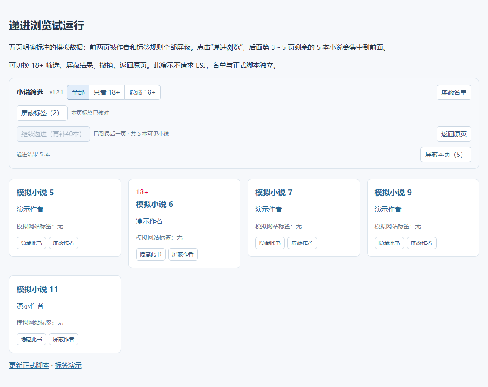

# ESJ 小说筛选助手

为 ESJ Zone 添加小说、作者和标签屏蔽，支持 18+ 筛选与跨页递进浏览。

看过、不感兴趣的小说可以直接隐藏；屏蔽累积到好几页之后，点击「递进浏览」，让后面未被屏蔽的小说集中显示，减少反复翻空页。

**[安装脚本](https://raw.githubusercontent.com/yuanmoukong-afk/esj-filter/main/esj-filter.user.js)** · **[下载最新版本](https://github.com/yuanmoukong-afk/esj-filter/releases/latest)** · **[反馈问题](https://github.com/yuanmoukong-afk/esj-filter/issues)**

## 功能

| 功能 | 用法 |
| --- | --- |
| 小说屏蔽 | 按书籍 ID 隐藏，改名或更新章节后仍然有效。 |
| 作者屏蔽 | 隐藏该作者的作品，减少逐本操作。 |
| 标签屏蔽 | 按网站「内容标签」精确匹配，命中任意一个屏蔽标签就隐藏。 |
| 18+ 筛选 | 「全部」「只看 18+」「隐藏 18+」三档切换。 |
| 整页屏蔽 | 一次屏蔽当前页符合筛选条件、实际显示的全部小说。 |
| 递进浏览 | 从当前分类、排序或标签入口的第一页开始，跨页补足 40 本；可以继续每次再补 40 本。 |
| 撤销与临时显示 | 撤销最近一次屏蔽，或临时显示隐藏的小说，方便恢复。 |
| 屏蔽名单管理 | 小说、作者、标签分开管理，支持搜索和批量取消。 |
| 名单备份 | 导出 JSON 文件，换浏览器或重装前保存；导入时合并已有名单。 |



## 安装与更新

1. 浏览器安装并启用 [篡改猴（Tampermonkey）](https://www.tampermonkey.net/)。
2. 点击上方「安装脚本」，在篡改猴打开的安装界面确认安装。
3. 刷新 ESJ 的小说列表页，确认工具栏显示 **v1.2.1**，并有「屏蔽标签」和「递进浏览」。

如果浏览器只显示源码，打开篡改猴的「添加新脚本」，全选替换为本仓库 `esj-filter.user.js` 的完整内容，再按 Ctrl+S 保存。运行权限按篡改猴提示设置，参见[官方安装说明](https://www.tampermonkey.net/faq.php?q=Q102)和[运行权限说明](https://www.tampermonkey.net/faq.php?q=Q209)。

**已有本项目旧版时，先导出备份，再更新原脚本。** 本版保留原来的脚本名称、命名空间与存储键，方便沿用名单。不要同时启用两份脚本。若之前手动安装的版本没有更新地址，在原脚本中替换一次完整代码并保存即可；本版已设置 GitHub 更新地址，后续由篡改猴按更新设置检查。

适配地址：`esjzone.one`、`www.esjzone.one`、`esjzone.cc`、`www.esjzone.cc` 的 HTTPS 页面。主要用于轻小说列表、搜索结果、作者和标签入口；在能识别元数据的详情页也提供屏蔽操作。

## 标签屏蔽如何工作

标签来自书籍详情旁的「内容标签／內容標籤」，不根据书名或简介猜测，也不会把作者、热门搜索当成内容标签。例如，书名里没有「女性主角」，但网站给它标了这个标签，仍会命中屏蔽。

初次使用默认加入「百合」和「女性主角」，可以在标签名单里取消；取消后不会自动加回。添加其他标签时，每行输入一个名称，也支持逗号分隔。取消某个标签屏蔽后，相关作品会重新按剩余规则筛选，不需要逐本恢复。

列表没有完整标签时，脚本使用当前 ESJ 登录状态依次读取书籍详情，一次一个请求，间隔 350 毫秒，成功结果缓存七天。不读取章节正文。读取失败时会暂停并显示尚未核对的数量，可点击重试；普通浏览中，尚未核对的书仍会显示。递进浏览只收录通过标签核对的结果，因此首次使用可能需要等待。

## 递进浏览如何工作

点击「递进浏览」，脚本沿当前入口的原有排序从第一页筛选，自动略过空页，集中展示剩余小说，目标为 40 本。不是预先下载全站，也不会改动网站服务器的分页。

- 「继续递进」保留当前结果，再补 40 本；同一本书按 ID 去重。
- 「停止加载」暂停请求；再次继续时从停下的位置处理。失败页重试时也不会被跳过。
- 「返回原页」恢复网站原分页，屏蔽名单继续保留。
- 在递进结果中整页屏蔽，会继续从后面的作品补位；撤销会恢复原顺序。
- 到末页后不足 40 本，显示实际剩余数量。刷新后递进状态结束，需要再次点击按钮，名单会保留。

## 导出与备份

点击「屏蔽名单」→「导出备份」，浏览器会下载 JSON 文件。备份包含小说、作者、标签名单和 18+ 设置。把文件另存一份，建议在大批屏蔽后或重装前导出。

恢复时，在同一位置点击「导入备份」并选择文件。导入会合并名单，不删除当前已有记录；18+ 设置恢复为备份中的设置。支持本项目旧版备份，标签缓存不导出，导入后按需重新核对。

名单保存在篡改猴本地存储，同一脚本实例的多个 ESJ 页面共用；不同设备、浏览器和配置文件之间需要导出、导入转移。脚本不上传名单。**GitHub 上的源码不包含你的个人屏蔽名单，下载或更新源码也不等于备份名单。**

更多操作细节见[使用说明](使用说明.md)。

## 演示与验证

下载仓库后，可以用浏览器打开 `标签试运行.html` 或 `递进试运行.html`。演示使用明确标注的模拟小说，不请求 ESJ，演示名单与正式脚本独立。

项目使用 Chromium 检查屏蔽、撤销、备份、跨页补位、标签区识别和失败重试；公开测试使用模拟网页和请求响应。发布前也使用网站保存页检查过列表结构。**尚未在已登录 ESJ 的篡改猴环境中完成在线验证**；登录状态、网站改版或请求限制可能影响详情标签读取和递进。

开发测试需要 Node.js 与 Playwright：

```sh
npm install
npx playwright install chromium
npm test
```

测试覆盖网站标签与书名、作者、热门搜索的区分，标签缓存与失败重试，备份校验，连续空页、去重、整页屏蔽后补位、停止与继续，以及筛选放宽后补回结果。

## 使用边界与反馈

- 18+ 依据网站明确显示的标记；未标记作品不作内容推断。
- 作者按名字匹配；同名可能一并命中，不同笔名不会自动关联。
- 屏蔽只影响列表展示，仍可以通过直接链接打开详情或章节。
- 普通隐藏不会改变网站显示的结果总数与页数；不想手动翻空页时使用递进浏览。

遇到问题请在[问题反馈](https://github.com/yuanmoukong-afk/esj-filter/issues)里说明脚本版本、浏览器、出问题的页面地址，以及预期和实际行为。截图可以帮助定位，无需提交私人名单或登录信息。

本项目为独立的用户脚本，与 ESJ Zone 官方无隶属关系。采用 [MIT 许可证](LICENSE)。
